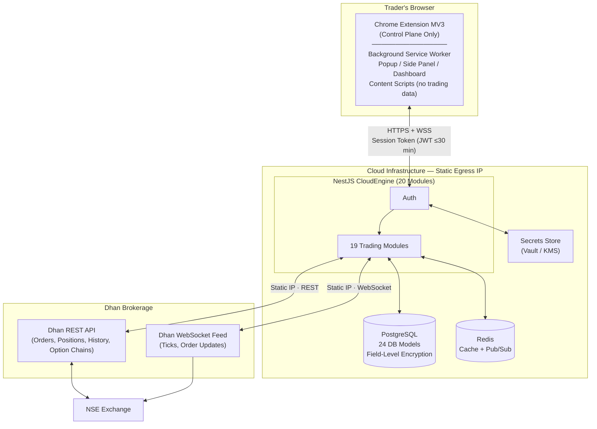
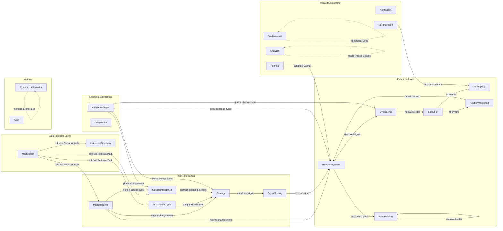

# Design Document

## Overview

MoneyPrinter is a risk-first, fully autonomous quantitative trading system targeting Indian NSE Index Options and F&O instruments. The system is a hybrid: a Google Chrome Extension (Manifest V3) operates as a zero-trust control plane, while a cloud-hosted NestJS application (the **CloudEngine**) is the sole authoritative trading engine, running independently of any browser session.

Capital preservation, regulatory compliance, and trade quality enforcement take precedence over opportunity capture in every design decision.

### Design Principles

1. **Risk over Reward** — The RiskEngine is the authoritative gatekeeper. No module, strategy, or user action can bypass a risk decision.
2. **Zero Auto-Re-arm** — Live trading requires explicit two-step user authorization and never restores automatically after any restart, reconnection, or token renewal.
3. **Paper / Live Isolation** — No code paths, database tables, Redis keys, or event bus channels are shared between PaperEngine and LiveEngine. Separation is enforced at the infrastructure level.
4. **Official API Only** — All broker interactions use exclusively documented Dhan/DhanHQ endpoints. No DOM scraping, no undocumented or private endpoints.
5. **Append-Only Audit Trail** — The TradeJournal implements append-only semantics. No record is modified or deleted after initial creation.
6. **Static Egress IP** — All outbound Dhan API connections route through a single, fixed IP address for Dhan API whitelist compliance.
7. **Secrets Never Leak** — No credentials, API keys, or session tokens appear in logs, environment variable exports, API responses, or any client-side storage accessible to web content.

### Scope Boundaries

| Concern | In Scope | Out of Scope |
|---------|----------|--------------|
| Order execution | Via official Dhan REST APIs | Direct exchange connectivity |
| Market data | Dhan WebSocket + REST | Third-party data vendors |
| Instruments | NSE F&O index options (NIFTY, BANKNIFTY, FINNIFTY, MIDCPNIFTY, SENSEX) + liquid F&O stock options | Equity delivery, currency, commodity |
| Broker | Dhan / DhanHQ exclusively | Multi-broker support |
| Trading horizon | Intraday only, full square-off by 15:15 IST | Positional / overnight |
| Execution mode | Paper and Live (isolated) | Simulated exchange matching engine |

---

## Architecture

### System Topology



### CloudEngine Module Interaction



### Communication Patterns

| Pattern | Usage |
|---------|-------|
| Redis Pub/Sub | Real-time events: tick data, regime changes, session phase, risk events, notifications |
| PostgreSQL transactions | Atomic multi-table writes (CapitalLedger update + position close, module-unavailable marking) |
| NestJS EventEmitter | Intra-process module-to-module events (low-latency, same process) |
| HTTPS + WSS | Extension ↔ CloudEngine (JWT-authenticated, TLS 1.2+) |
| Dhan REST | Order placement, modification, cancellation, historical data, option chains |
| Dhan WebSocket | Real-time tick data, live order status updates |

### Deployment Model

| Component | Specification |
|-----------|--------------|
| CloudEngine | Single NestJS process, 20 NestJS modules, Node.js 20 LTS |
| Outbound IP | Static / Elastic IP for Dhan API whitelist |
| PostgreSQL | Managed instance, field-level encryption on sensitive columns |
| Redis | Managed instance, used for both caching and pub/sub |
| TLS | TLS 1.2 minimum, terminated at load balancer |
| Secrets | HashiCorp Vault or cloud-native KMS (AWS Secrets Manager / GCP Secret Manager) |

---

## Components and Interfaces

### Chrome Extension

The Extension is a **read-mostly control plane**. It never executes trades, computes signals, or holds broker state. Its sole write path to the CloudEngine is the arm/disarm toggle — and that requires two explicit user actions.

#### Background Service Worker (BSW)

- Maintains the single WSS connection to CloudEngine
- Persists `{ armedState, sessionToken, connectionState }` in `chrome.storage.session` (ephemeral, not synced across devices)
- On startup: reads from `chrome.storage.session`, attempts reconnection; if state is not fully recovered within 5 seconds → disarms and notifies user that manual re-authorization is required
- **Never** auto-re-arms after any restart, token renewal, or browser update
- Routes CloudEngine push notifications to the appropriate UI component

#### Extension UI Components

| Component | Purpose | Key State Displayed |
|-----------|---------|---------------------|
| Popup | ARM / DISARM (two-step), system health badge, quick P&L summary | Armed state, active positions count, session P&L |
| Side Panel | Live position monitor, recent signal feed, alert queue | Open positions with real-time P&L, last 10 signals |
| Full Dashboard | Complete analytics, strategy performance, capital chart, regime heatmap, Options Flow | All performance metrics, attribution, compounding simulator |
| Content Scripts | No trading functionality; no access to broker page state | — |

#### Extension Security Invariants

- Broker credentials, API keys, and Dhan session tokens are **never** stored in extension local storage, content script context, `window.postMessage`, or any DOM-accessible location
- Session tokens live in `chrome.storage.session` only
- All communication to CloudEngine is over WSS or HTTPS exclusively — no plaintext HTTP

---

### CloudEngine Modules

#### Module 1: Auth

**Responsibilities:** Issues and validates session tokens; manages authentication lifecycle; writes to AuditLogs for every auth event; retrieves broker credentials from the secrets store.

**Key API Endpoints:**
```
POST /auth/login         → { sessionToken: string, expiresAt: ISO8601 }
POST /auth/refresh       → { sessionToken: string, expiresAt: ISO8601 }
POST /auth/logout        → 204 No Content
GET  /auth/status        → { authenticated: bool, armedState: string, sessionExpiresAt: ISO8601 }
```

**Design Notes:**
- JWTs are short-lived (configurable, max 30 minutes), signed with RS256
- Token expiry causes the Extension to disconnect and enter disarmed state
- Every auth event (login, logout, failure, token expiry) → `AuditLogs` record with user ID, event type, UTC timestamp, outcome

---

#### Module 2: MarketData

**Responsibilities:** Maintains the Dhan WebSocket feed; distributes ticks via Redis pub/sub; caches snapshots with TTLs; monitors feed staleness; manages reconnection with exponential backoff.

**Reconnection Schedule (Dhan WebSocket):**

| Attempt | Delay |
|---------|-------|
| 1 | 1 s |
| 2 | 2 s |
| 3 | 4 s |
| 4 | 8 s |
| 5 | 16 s (effective cap: 30 s) |

After 5 consecutive failures → publish `connectivity-failure` alert to NotificationService via Redis within 5 seconds.

**First-Tick SLA:** After WebSocket connection is confirmed, the first incoming tick data message must be received within 3 seconds.

**Redis Keys:**

| Key | TTL | Content |
|-----|-----|---------|
| `mkt:snapshot:{instrument_id}` | 2 s | LTP, bid, ask, volume, OI, timestamp |
| `mkt:optchain:{underlying}:{expiry}` | 10 s | Full option chain JSON |
| `events:tick:{instrument_id}` | — (pub/sub channel) | Tick payload |

---

#### Module 3: InstrumentDiscovery

**Responsibilities:** Scans the NSE F&O universe at market open; computes composite liquidity scores; manages the active trading universe; rotates WebSocket subscriptions at quota thresholds; classifies instruments as UNDERLYING or TRADABLE_OPTION.

**Liquidity Score (0–100):**

| Component | Weight | Source |
|-----------|--------|--------|
| Volume vs. 30-day average | 25% | MarketData |
| Open Interest | 25% | MarketData |
| Bid-Ask Spread (inverted) | 20% | MarketData |
| Market Depth (sum of top-5 levels) | 15% | MarketData |
| Qty at best bid + best ask | 15% | MarketData |

**Subscription Quota Management:**
- At 90% of configured Dhan WebSocket subscription limit → rotate: drop lowest-scored instruments until below 80% of limit
- Underlying indices (NIFTY, BANKNIFTY, FINNIFTY, MIDCPNIFTY, SENSEX) are **never** submitted to ExecutionService regardless of any other logic

**Failure Mode:** If scan fails to complete within 5 minutes of market open → retain prior session universe, emit `SCAN_FAILURE` to NotificationService, record in `SystemHealthEvents`.

---

#### Module 4: MarketRegime

**Responsibilities:** Classifies the market into exactly one of 10 regimes at ≤60-second intervals; publishes regime-change events; enforces VIX override rule; persists every classification.

**10 Market Regimes:**

| Code | Description |
|------|-------------|
| `STRONG_BULL` | Strong directional up move, expanding volume, positive breadth |
| `WEAK_BULL` | Moderate upward bias, mixed breadth |
| `STRONG_BEAR` | Strong directional down move, expanding volume, negative breadth |
| `WEAK_BEAR` | Moderate downward bias, mixed breadth |
| `SIDEWAYS` | Low directional movement, mean-reverting price action |
| `HIGH_VOL` | VIX above configured threshold OR abnormal ATR expansion |
| `LOW_VOL` | VIX below configured floor, compressed ATR |
| `BREAKOUT` | Price breaking beyond prior consolidation range with volume |
| `REVERSAL` | Price rejecting key level with volume confirmation |
| `UNSTABLE` | Conflicting signals, classification confidence below threshold |

**Classification Inputs:** NIFTY price trend, BANKNIFTY price trend, market breadth, Advance/Decline ratio, VWAP deviation, India VIX, ATR, relative volume, sector strength, futures basis.

**VIX Override Rule:** If VIX > `high_volatility_threshold` → output is `HIGH_VOL` regardless of price trend indicators. This rule is evaluated before any other classification logic.

**Redis Key:** `regime:current` (TTL: 300 s); `events:regime_change` (pub/sub)

---

#### Module 5: TechnicalAnalysis

**Responsibilities:** Computes technical indicators on demand for the StrategyEngine. No persistent state; recomputes from HistoricalCandles + current ticks.

**Computed Indicators:** VWAP, ATR (configurable period), EMA (9, 21, 50, 200), Support/Resistance levels, ORB range (first 15-minute high/low), MACD, RSI (14), relative volume.

---

#### Module 6: OptionsIntelligence

**Responsibilities:** Computes Greeks from live option chain data (max age: 60 seconds); selects contracts meeting all configured criteria; tracks IV regime per underlying; applies expiry-day controls; computes Theta decay in ₹/calendar-day; signals illiquid contracts to SignalScorer.

**Contract Selection Criteria (all must be satisfied simultaneously):**
1. Delta ∈ [configured_min_delta, configured_max_delta] where both values are in (0.01, 0.99)
2. IV rank ∈ [configured_min_iv_percentile, configured_max_iv_percentile] (1–100 of 52-week IV range)
3. OI ≥ configured_min_oi (whole contract count)
4. Depth qty at best bid ≥ configured_min_depth_qty AND depth qty at best ask ≥ configured_min_depth_qty

**IV Regime Classification per Underlying:**
```
current_iv > baseline_avg + threshold_pp  →  EXPANDING
current_iv < baseline_avg - threshold_pp  →  CONTRACTING
otherwise                                 →  NEUTRAL
```
IV regime weight factors for contract selection and R:R estimation are independently configurable.

**Expiry Day Special Controls (when trading_date = expiry_date):**
1. Required entry signal score = standard_threshold + configurable_positive_delta
2. Maximum position size = configured_expiry_day_size_limit (10%–90% of standard maximum)
3. Mandatory square-off time = configured_expiry_square_off_time (12:00–14:30 IST), which must precede the standard 15:15 IST square-off

**Theta Decay:** Expressed as a non-negative magnitude ≥ 0 in ₹/calendar-day; provided to PositionMonitor for exit condition evaluation.

**Illiquid Contract Signal:** If bid-ask spread > configured_max_spread_threshold → mark contract as illiquid; SignalScorer applies configured liquidity penalty to the Liquidity/Execution Feasibility score component.

---

#### Module 7: Strategy (StrategyEngine)

**8 Strategies:**

| Code | Name | Primary Setup | Key Technical Inputs |
|------|------|---------------|---------------------|
| A | Opening Range Breakout | First 15-min range breakout with volume | ORB high/low, ATR, relative volume |
| B | VWAP Reclaim & Rejection | Price reclaims or rejects VWAP decisively | VWAP, volume delta, price structure |
| C | Momentum Expansion | Trend with expanding momentum confirmation | RSI, MACD, relative volume, EMA slope |
| D | Breakout & Retest | Consolidation breakout, retest as support/resistance | S/R levels, volume profile, ATR |
| E | Trend Continuation | Pullback to EMA in established trend | EMA ribbon, ADX, volume |
| F | Liquidity Sweep & Reversal | Stop-hunt sweep → strong reversal | OI, volume spike, wick analysis, breadth |
| G | Fair Value Gap & Market Structure | FVG fill + market structure break | FVG zones, swing point structure |
| H | Options Flow Intelligence | Institutional options positioning signal | OI change, PCR, IV skew, large-block detection |

**Strategy Evaluation Flow (sequential gate evaluation):**
1. Check regime availability → if regime unavailable: skip all, record skip reason `"regime unavailable"`
2. Check regime compatibility → if current regime not in `compatible_regimes`: skip, record `"incompatible regime"`
3. Apply entry condition checks
4. Compute R:R ratio → if R:R < `min_rr_ratio`: skip
5. Generate signal record → forward to SignalScoring

**Every evaluation** (signal produced OR skipped) is recorded in `SignalEvaluations` table with skip reason.

**Adaptive Strategy Engine:**
- When enabled: rank strategy priority by validated out-of-sample win rate for the current regime over trailing 20 trading days (higher win rate = higher priority)
- If a strategy's out-of-sample win rate < `configured_min_performance_threshold` → suspend the strategy, publish `strategy-degradation` alert; re-enabled only by explicit user action

---

#### Module 8: SignalScoring

**8-Component Scoring (total max: 100 points):**

| Component | Max Points | Description |
|-----------|-----------|-------------|
| Regime Alignment | 15 | Alignment strength between signal direction and current regime |
| Price Structure | 15 | Quality of price action setup (entry candle, S/R quality) |
| Volume Confirmation | 15 | Volume supporting the directional move |
| Momentum | 10 | RSI, MACD, and momentum indicator alignment |
| VWAP / Trend Alignment | 10 | Price position relative to VWAP and EMA trend |
| Options / Futures Confirmation | 15 | OI, IV, Greeks, PCR, futures basis confirmation |
| Liquidity / Execution Feasibility | 10 | Bid-ask spread, depth, contract liquidity (penalty applied for illiquid contracts) |
| R:R Quality | 10 | Ratio quality relative to strategy's configured minimum |

**Scoring Rules:**
- If R:R < strategy's configured `min_rr_ratio` → R:R Quality component score = 0 (hard rule, not configurable)
- Composite score = sum of all 8 component scores
- If composite score < 80 → rejected for live trading; status = `"rejected"`, rejection_reason = `"score below threshold"`
- If signal not acted upon within configured `max_validity_duration` → status = `"expired"`
- If entry price deviates from current market price by > configured strategy-specific threshold before order submission → recompute composite score and re-validate against 80-point threshold before ExecutionService submits

**Signal Record (all fields persisted to Signals table):**
`signal_id, strategy_id, instrument_id, entry_price, stop_loss_price, target_price, position_size, composite_score, [8 component scores], [8 measured input values], status, rejection_reason, signal_timestamp, expiry_timestamp, dhan_order_id`

---

#### Module 9: Portfolio

**Responsibilities:** Maintains authoritative portfolio state (open positions + pending orders) in memory with PostgreSQL persistence; computes and maintains Dynamic_Capital; writes CapitalLedger records for every capital movement.

**Dynamic_Capital Definition:**
```
Dynamic_Capital = starting_capital
                + SUM(realized_net_pnl for all closed trades)
where realized_net_pnl per trade = gross_pnl − (brokerage + STT + exchange_charges + GST + SEBI_charges + stamp_duty)
```

**CapitalLedger Update SLA:** After a trade closes → CapitalLedger updated and Dynamic_Capital recomputed within 500 milliseconds, before any subsequent signal evaluation.

**On CapitalLedger Failure:** If CapitalLedger update or Dynamic_Capital recomputation fails → halt all new signal evaluations immediately; retain last successfully committed balance; record error in `SystemHealthEvents` within 1 second.

---

#### Module 10: RiskManagement (RiskEngine)

The RiskEngine is authoritative. No other module can override a risk decision.

**Position Sizing Formula:**
```
risk_amount = Dynamic_Capital × configured_risk_percentage
quantity    = FLOOR(risk_amount / (|entry_price − stop_loss_price| × lot_size))
```
Quantity is truncated down to the nearest whole lot.

**Pre-Entry Risk Gates (any single failure → order rejected, user notified with specific failing gate):**

| Gate | Condition |
|------|-----------|
| Per-trade loss limit | Order risk_amount ≤ configured max per-trade monetary loss |
| Total exposure limit | (current_exposure + order_exposure) ≤ configured max % of Dynamic_Capital |
| Correlated exposure | Same-underlying exposure ≤ configured max correlated exposure |
| Concurrent trades | Open positions count < configured max concurrent open trades |
| Concentration | Single-instrument exposure ≤ configured max concentration |
| Signal score | Composite score ≥ 80 |
| Zero per-unit risk | \|entry_price − stop_loss_price\| > 0 (else reject with `"zero per-unit risk"`) |
| Invalid lot_size | lot_size > 0 and configured (else reject with `"invalid lot_size configuration"`) |

**Daily Loss State Machine:**

```
Normal
  → [2nd losing trade closed]       → TWO_LOSS_LOCKOUT (resets next calendar day 00:00 IST)
  → [intraday net loss ≥ daily limit] → EMERGENCY_HALT (resets next calendar day)

Any State
  → [kill switch activated]         → KILL_SWITCH_ACTIVE
                                        cancel all open orders
                                        submit market exit for all positions
                                        SLA: all actions within 10 seconds
```

**VIX Position Size Controls:**
- VIX > `unusual_volatility_threshold` → reduce max position size to `volatility_protection_limit`
- VIX < threshold for 5 consecutive minutes after reduction → restore to normal configured limit

**Data Staleness:** If market data age > `max_allowed_data_age` → block all new order submissions until fresh data is confirmed.

---

#### Module 11: Execution (ExecutionService)

**Responsibilities:** Full order lifecycle management; idempotency key enforcement; Dhan REST API order operations; order record persistence.

**Pre-Trade Validation Chain (5 checks, executed in order):**
1. Signal composite score ≥ 80
2. RiskEngine has approved the signal
3. Available margin (from Dhan portfolio) ≥ required margin for the order
4. No duplicate order exists for the same instrument + direction
5. Current time is within regular market session AND before configured mandatory square-off time

If any check fails → reject without broker submission; return error identifying the specific failing check.

**Idempotency:**
- Each order is assigned a UUID idempotency key stored in Redis with 5-minute expiry: `orders:idempotency:{key}`
- Before submitting to Dhan API → check Redis for key; if key exists → return `duplicate-order-rejected` without Dhan API call

---

#### Module 12: PaperTrading (PaperEngine)

**Complete Isolation Guarantee:**
- Dedicated PostgreSQL tables (prefixed `paper_`)
- Dedicated Redis key namespace (`paper:*`)
- Dedicated event bus channels (`events:paper:*`)
- No shared service instances, message handlers, or middleware with LiveEngine

**Simulation Models:**

*Slippage:*

| Model | Valid Range | Default |
|-------|-------------|---------|
| Fixed rupee | 0.00 – 50.00 ₹ | 0.00 ₹ |
| Percentage of price | 0.00% – 2.00% | 0.00% |
| Market impact | configurable model parameters | — |

*Fill Price Rules:*
- Buy order → fill at current best ask + slippage
- Sell order → fill at current best bid − slippage
- If best bid or best ask is unavailable → reject order; preserve existing portfolio state and P&L; record rejection reason `"market data unavailable"`

*Rejection Probability:* configurable [0.00, 1.00] (default 0.00). If selected for rejection → return status `rejected`; deduct no charges; record no P&L change.

*Execution Latency:* configurable distribution (uniform / normal / log-normal), configurable mean (10–5000 ms), default: uniform with mean 200 ms. Zero-latency instantaneous fills are **not** the default.

**Cost Model:** Identical formulas to LiveEngine — brokerage, STT, NSE exchange charges, GST, SEBI, stamp duty — applied to every simulated fill.

---

#### Module 13: LiveTrading (LiveEngine)

**Two-Step Arming State Machine:**

```
DISARMED
  → User clicks "Activate Live Mode"  → ARMED_PENDING
  → User clicks "Confirm Arm"         → ARMED

ARMED_PENDING
  → Timeout or cancellation           → DISARMED

ARMED
  → CloudEngine restart               → DISARMED (requires explicit re-authorization)
  → Browser update                    → DISARMED
  → Dhan session token renewal        → DISARMED
  → User disarms                      → DISARMED
```

A single user action cannot transition from DISARMED to ARMED.

**Pre-Trade Validation:** Delegates to ExecutionService's 5-check validation chain.

**Session-Aware Entry Blocking:**
- Current time ≥ 14:30 IST (Closing phase) → block all new entries
- Active two-loss lockout → block all new entries
- Active daily loss halt → block all new entries

**Mandatory Square-off (15:15 IST):** Submit market exit orders for all open positions. Record `mandatory-exit` compliance event in TradeJournal with exit timestamp and all affected position IDs.

**Kill Switch:** All open orders cancelled + market exit orders submitted within 10 seconds. If any orders or positions remain open after 10 seconds → alert user identifying specific items requiring manual intervention.

---

#### Module 14: TrailingStop (TrailingStopEngine)

**8 Trailing Stop Mechanisms:**

| # | Mechanism | Description |
|---|-----------|-------------|
| 1 | ATR-based | SL trails at N × ATR below (long) / above (short) the current highest price reached |
| 2 | Swing High / Low | SL placed below prior swing lows (long) / above prior swing highs (short) |
| 3 | Chandelier Exit | SL = highest high over N periods − M × ATR (long); inverse for short |
| 4 | Percentage-based | SL trails at configured % below/above the current highest favorable price |
| 5 | Volatility-adjusted | ATR-based with IV regime multiplier (wider in EXPANDING, tighter in CONTRACTING) |
| 6 | Structure-based | SL anchored to significant support / resistance level closest to entry |
| 7 | Time-based | SL progressively tightens as configured time-to-close deadline approaches |
| 8 | Partial-profit | Exit configured partial quantity at first target; move SL to configured post-partial stop level |

**Core Invariant — SL Monotonicity in Profit Direction:**
- Long position: new SL ≥ current SL (SL only moves higher)
- Short position: new SL ≤ current SL (SL only moves lower)
- This invariant is enforced atomically in a single conditional-write before any SL update is persisted

**Broker-Side SL via Dhan Super Orders:**
- Register SL with Dhan Super Orders within 5 seconds of trailing stop activation
- Maintain an internal SL level independent of broker SL state
- If no Super Order confirmation received for any open position → treat broker-side SL as inactive; submit replacement SL order

**SL Rejection Escalation Ladder:**

| Consecutive Rejections | Action |
|------------------------|--------|
| 1 or 2 | Submit replacement SL within 5 s; publish CRITICAL alert to NotificationService |
| 3 or more | MAX-priority alert to NotificationService; disable all new entries until user ACKs |
| User ACK | Reset consecutive rejection counter to 0 for that position |

---

#### Module 15: PositionMonitoring (PositionMonitor)

**Responsibilities:**
- Continuously tracks MFE (Maximum Favorable Excursion) and MAE (Maximum Adverse Excursion) for every open position from a subscribed tick feed
- Evaluates exit conditions: SL hit, target hit, trailing stop trigger, time-based exit, Theta decay threshold
- Integrates Theta decay (₹/day from OptionsIntelligence) into exit condition evaluation
- Feeds real-time unrealized P&L to RiskEngine for emergency halt threshold monitoring
- Detects expiry-day mandatory square-off time and triggers square-off if configured

---

#### Module 16: TradeJournal

**Append-Only Record Sets:**

| Record Set | Key Write Trigger | SLA |
|------------|-------------------|-----|
| signals | Signal generated | 5 s |
| rejected_signals | Signal rejected (any reason) | 5 s |
| orders | Order submitted or modified | 5 s |
| fills | Execution fill received from Dhan | 5 s |
| positions | Position opened or closed | 5 s |
| completed_trades | Trade closed | 5 s |
| risk_events | Any risk event (lockout, halt, kill switch, SL rejection) | 1 s |
| system_errors | Module failure or unhandled exception | 1 s |
| configuration_changes | Any user-initiated config change | 5 s |

**Write Semantics:** Append-only. No UPDATE or DELETE is ever issued on journal tables.

**Write Retry:** Up to 3 retries within 30 seconds. On all-retry failure → emit operator alert identifying record type and failure reason. Records are **never** silently dropped.

**Trade Completion Record Fields:**
`trade_id, instrument, strategy, signal_score, entry_price, exit_price, quantity, entry_time, exit_time, MFE, MAE, gross_pnl, brokerage, STT, exchange_charges, GST, SEBI_charges, stamp_duty, net_pnl, exit_reason, execution_slippage, dhan_entry_order_id, dhan_exit_order_id`

---

#### Module 17: Analytics (AnalyticsService)

**Performance Metrics (per engine × per time window):**

Time windows: Current Session, Last 30 Days, All-Time.

| Metric | Insufficient Data Guard (< 30 trades) |
|--------|--------------------------------------|
| Win rate | Always shown |
| Expectancy | Always shown |
| Average win / average loss | Always shown |
| R:R ratio | Always shown |
| Maximum drawdown | Always shown |
| Maximum consecutive wins/losses | Always shown |
| Profit factor | **Suppressed** — show "insufficient data — fewer than 30 trades" |
| Sharpe ratio | **Suppressed** |
| Sortino ratio | **Suppressed** |
| Calmar ratio | **Suppressed** |

**Attribution Breakdowns:** By strategy, by instrument, by market regime, by time-of-day bucket (each bucket = 60 minutes).

**Trade Quality Forensics (computed on every trade close):**
```
QCR = actual_net_pnl / MFE

Exit Classification:
  Premature   → QCR < 0.70
  Near-optimal→ QCR ≥ 0.70 AND exit_time ≤ mfe_time
  Late        → QCR ≥ 0.70 AND exit_time > mfe_time

Execution Quality:
  Poor               → QCR < 0.40
  Fair               → 0.40 ≤ QCR < 0.70
  Good               → 0.70 ≤ QCR < 0.90
  Excellent          → QCR ≥ 0.90
  No Favorable Excursion → MFE = 0 (QCR undefined, no division performed)
```

**Daily Trading Intelligence Report (generated at session end):** Trade summary, regime observations, strategy performance, capital changes, and for each generated-but-not-executed signal: the specific threshold criterion that was not met.

**Capital Compounding Simulator:**
- Horizon: 1, 3, or 5 years
- Compounding frequency: daily, weekly, or monthly
- Withdrawal rate: 0%–100% in 1% increments
- Based on historical performance statistics from the selected time window

---

#### Module 18: Notification (NotificationService)

**Responsibilities:** Delivers alerts to Extension via WebSocket push. Maintains a priority queue (MAX > CRITICAL > WARNING > INFO). Tracks acknowledgment for MAX-priority SL escalation alerts. Buffers and retries undelivered alerts — no alert is silently dropped.

---

#### Module 19: Compliance

**Responsibilities:** Validates strategies against quantitative deployment gates before allowing live trading. Records all gate pass/fail outcomes in the `Strategies` table.

**Live Deployment Profitability Gates (all 4 must pass):**

| Gate | Criterion |
|------|-----------|
| Out-of-sample expectancy | Positive (> 0) |
| Maximum drawdown | ≤ configured drawdown threshold |
| Minimum sample | ≥ 30 closed trades per regime tested |
| Monte Carlo robustness | ≥ 1,000 iterations; ≥ 95% yield positive out-of-sample expectancy |

If any gate fails → block strategy from live trading; record failing criterion and computed value in `Strategies` table.

**BacktestEngine Configuration:**
- Walk-forward validation + out-of-sample testing for all 8 strategies
- No look-ahead bias, no survivorship bias
- In-sample to out-of-sample split ratio: configurable 50%–90% in-sample
- Same cost model as PaperEngine (brokerage, STT, exchange, GST, SEBI, stamp duty per simulated trade)
- 95% confidence intervals for expectancy, win rate, and max drawdown via bootstrap resampling (≥ 1,000 resamples)

---

#### Module 20: Reconciliation (ReconciliationService)

**Three Reconciliation Types:**

| Type | Trigger | Deadline |
|------|---------|---------|
| End-of-day | NSE session closes (15:30 IST) | Within 30 minutes |
| Reconnection | DhanAPI reconnection confirmed | Within 30 seconds |
| SL status verification | TrailingStopEngine request after reconnect | Within 60 seconds |

**Discrepancy Definition:** Any non-zero difference in net position quantity or instrument between CloudEngine records and Dhan broker records.

**On Discrepancy Detected:** Halt **new** order submissions (allow modification and cancellation of existing orders) until user explicitly acknowledges, or records return to full agreement.

**Reconciliation Report:** Confirms CloudEngine net P&L = Dhan broker net P&L = CapitalLedger closing balance within ₹1 tolerance.

**Unrecognized Fill:** If Dhan reports a fill with no matching CloudEngine order ID → flag as unrecognized execution; publish alert to NotificationService within 10 seconds.

**All runs, discrepancies, and resolution actions → `AuditLogs` table.**

---

### NSE Session Phase Management

The SessionManager tracks 8 session phases and publishes phase-change events consumed by StrategyEngine, RiskEngine, LiveEngine, and OptionsIntelligence.

| Phase | IST Window | Key System Behavior |
|-------|-----------|---------------------|
| Pre-market | 09:00 – 09:15 | System checks, data pre-load, no orders |
| Opening Volatility | 09:15 – 09:20 | Restrict to opening-phase-compatible strategies only |
| ORB Formation | 09:15 – 09:30 | ORB level computation; Strategy A available |
| Morning Momentum | 09:30 – 11:00 | All strategies eligible, full regime evaluation |
| Mid-session | 11:00 – 13:00 | Full strategy evaluation |
| Afternoon | 13:00 – 14:30 | Full evaluation; expiry-day controls active if applicable |
| Closing | 14:30 – 15:30 | **No new entries**; monitor exits and trailing stops only |
| End-of-Day Reconciliation | 15:30 – 16:00 | Full EOD reconciliation run; analytics generation |

**Critical Time Events:**
- 14:30 IST → LiveEngine blocks all new position entries
- 15:15 IST → LiveEngine submits market exits for all remaining open positions; records `mandatory-exit` compliance event
- 15:30 IST → ReconciliationService begins EOD reconciliation (must complete within 30 minutes)

---

### Security Architecture

#### Authentication and Token Lifecycle
- JWTs signed with RS256, max validity 30 minutes
- Token expiry → Extension disconnects, enters DISARMED state, prompts re-authentication
- Every auth event recorded in AuditLogs: user ID, event type, UTC timestamp, outcome

#### Secrets Management
- Broker credentials, Dhan API keys, and session tokens stored in dedicated secrets store (Vault / KMS)
- Field-level AES-256-GCM encryption on sensitive PostgreSQL columns: `BrokerAccounts.account_id`, `BrokerSessions.session_token`, sensitive `AuditLogs` fields
- No secret value appears in application logs, environment variable exports, or API responses

#### Rate Limiting
- Per-endpoint, per-authenticated-client limit (default: 100 req/min, configurable)
- HTTP 429 response includes `Retry-After` header (strictly positive integer seconds)

#### CSRF Protection
- All state-modifying endpoints (order submission, config changes, kill switch, arming/disarming, auth actions) require a CSRF token
- CSRF tokens rotated per session

#### Order Idempotency
- Every order assigned a UUID idempotency key with 5-minute validity window
- Duplicate key within validity window → `duplicate-order-rejected` response, no Dhan API call

#### Data Classification

| Classification | Examples | Protection |
|---------------|---------|------------|
| SECRET | Dhan credentials, API keys | Secrets store + field-level encryption |
| CONFIDENTIAL | Session tokens, account IDs | Field-level encryption |
| INTERNAL | P&L data, trade records | Row-level access control |
| OPERATIONAL | System health, metrics | Standard access control |

---

## Data Models

The CloudEngine maintains exactly 24 PostgreSQL models. All models use UUID primary keys. Sensitive fields use field-level AES-256-GCM encryption (marked `ENCRYPTED`).

### 1. UserSettings
```
id              UUID         PK
user_id         UUID         FK → users
setting_key     TEXT         NOT NULL
setting_value   TEXT
created_at      TIMESTAMPTZ  NOT NULL DEFAULT NOW()
updated_at      TIMESTAMPTZ  NOT NULL DEFAULT NOW()
UNIQUE (user_id, setting_key)
```

### 2. BrokerAccounts
```
id              UUID         PK
user_id         UUID         FK → users
broker_name     TEXT         NOT NULL  -- "DHAN"
account_id      TEXT         ENCRYPTED NOT NULL
is_active       BOOLEAN      NOT NULL DEFAULT true
created_at      TIMESTAMPTZ  NOT NULL DEFAULT NOW()
updated_at      TIMESTAMPTZ  NOT NULL DEFAULT NOW()
```

### 3. BrokerSessions
```
id                  UUID         PK
broker_account_id   UUID         FK → BrokerAccounts
session_token       TEXT         ENCRYPTED NOT NULL
token_expiry        TIMESTAMPTZ  NOT NULL
created_at          TIMESTAMPTZ  NOT NULL DEFAULT NOW()
revoked_at          TIMESTAMPTZ  NULL
```

### 4. Instruments
```
id               UUID         PK
dhan_security_id TEXT         NOT NULL UNIQUE
symbol           TEXT         NOT NULL
exchange         TEXT         NOT NULL  -- "NSE_FNO"
instrument_type  TEXT         NOT NULL  -- "INDEX_OPTION" | "STOCK_OPTION" | "FUTURE" | "INDEX"
underlying       TEXT         NOT NULL  -- e.g. "NIFTY", "BANKNIFTY"
expiry_date      DATE         NULL
strike_price     NUMERIC(12,2) NULL
option_type      TEXT         NULL  -- "CE" | "PE"
lot_size         INTEGER      NOT NULL
is_active        BOOLEAN      NOT NULL DEFAULT false
liquidity_score  NUMERIC(5,2) NOT NULL DEFAULT 0  -- 0.00–100.00
last_scan_at     TIMESTAMPTZ  NULL
created_at       TIMESTAMPTZ  NOT NULL DEFAULT NOW()
INDEX (underlying, expiry_date, option_type)
INDEX (is_active, liquidity_score DESC)
```

### 5. MarketSnapshots
```
id              UUID         PK
instrument_id   UUID         FK → Instruments
ltp             NUMERIC(12,2) NOT NULL
bid             NUMERIC(12,2) NOT NULL
ask             NUMERIC(12,2) NOT NULL
bid_qty         INTEGER      NOT NULL
ask_qty         INTEGER      NOT NULL
volume          BIGINT       NOT NULL
oi              BIGINT       NOT NULL
timestamp       TIMESTAMPTZ  NOT NULL
INDEX (instrument_id, timestamp DESC)
```

### 6. HistoricalCandles
```
id              UUID         PK
instrument_id   UUID         FK → Instruments
granularity     TEXT         NOT NULL  -- "1m" | "5m" | "15m" | "1d"
open            NUMERIC(12,2) NOT NULL
high            NUMERIC(12,2) NOT NULL
low             NUMERIC(12,2) NOT NULL
close           NUMERIC(12,2) NOT NULL
volume          BIGINT       NOT NULL
oi              BIGINT       NULL
timestamp       TIMESTAMPTZ  NOT NULL
UNIQUE (instrument_id, granularity, timestamp)
INDEX (instrument_id, granularity, timestamp DESC)
```
Retention: 1m / 5m → 90 days; 15m → 1 year; 1d → 5 years.

### 7. OptionChainSnapshots
```
id              UUID         PK
underlying      TEXT         NOT NULL
expiry_date     DATE         NOT NULL
snapshot_data   JSONB        NOT NULL  -- full chain with Greeks
captured_at     TIMESTAMPTZ  NOT NULL
INDEX (underlying, expiry_date, captured_at DESC)
```

### 8. MarketRegimes
```
id                       UUID         PK
regime                   TEXT         NOT NULL  -- one of 10 regime codes
timestamp                TIMESTAMPTZ  NOT NULL
nifty_trend              NUMERIC(8,4)
banknifty_trend          NUMERIC(8,4)
breadth                  NUMERIC(8,4)
ad_ratio                 NUMERIC(8,4)
vwap_deviation           NUMERIC(8,4)
vix                      NUMERIC(8,4)
atr                      NUMERIC(8,4)
relative_volume          NUMERIC(8,4)
sector_strength          NUMERIC(8,4)
futures_basis            NUMERIC(8,4)
classification_rationale TEXT
created_at               TIMESTAMPTZ  NOT NULL DEFAULT NOW()
INDEX (timestamp DESC)
```

### 9. Strategies
```
id                        UUID         PK
name                      TEXT         NOT NULL
code                      TEXT         NOT NULL UNIQUE  -- "A".."H"
entry_conditions          JSONB        NOT NULL
exit_conditions           JSONB        NOT NULL
invalidation_conditions   JSONB        NOT NULL
compatible_regimes        TEXT[]       NOT NULL
min_rr_ratio              NUMERIC(4,2) NOT NULL  -- 1.0–10.0
max_concurrent_positions  INTEGER      NOT NULL  -- 1–20
is_active                 BOOLEAN      NOT NULL DEFAULT true
is_suspended              BOOLEAN      NOT NULL DEFAULT false
min_performance_threshold NUMERIC(5,2) NOT NULL  -- 0–100
opening_phase_compatible  BOOLEAN      NOT NULL DEFAULT false
created_at                TIMESTAMPTZ  NOT NULL DEFAULT NOW()
updated_at                TIMESTAMPTZ  NOT NULL DEFAULT NOW()
```

### 10. StrategyVersions
```
id                      UUID         PK
strategy_id             UUID         FK → Strategies
version                 INTEGER      NOT NULL
configuration_snapshot  JSONB        NOT NULL
created_at              TIMESTAMPTZ  NOT NULL DEFAULT NOW()
created_by              UUID         NOT NULL
UNIQUE (strategy_id, version)
```

### 11. Signals
```
id                          UUID         PK
strategy_id                 UUID         FK → Strategies
instrument_id               UUID         FK → Instruments
entry_price                 NUMERIC(12,2) NOT NULL
stop_loss_price             NUMERIC(12,2) NOT NULL
target_price                NUMERIC(12,2) NOT NULL
position_size               INTEGER       NOT NULL  -- quantity in lots
composite_score             NUMERIC(5,2)  NOT NULL
regime_alignment_score      NUMERIC(4,2)  NOT NULL
price_structure_score       NUMERIC(4,2)  NOT NULL
volume_confirmation_score   NUMERIC(4,2)  NOT NULL
momentum_score              NUMERIC(4,2)  NOT NULL
vwap_trend_score            NUMERIC(4,2)  NOT NULL
options_futures_score       NUMERIC(4,2)  NOT NULL
liquidity_score_component   NUMERIC(4,2)  NOT NULL
rr_quality_score            NUMERIC(4,2)  NOT NULL
rr_ratio                    NUMERIC(6,2)  NOT NULL
measured_inputs             JSONB         NOT NULL  -- 8 input measurements
status                      TEXT          NOT NULL  -- "pending"|"accepted"|"rejected"|"expired"|"executed"
rejection_reason            TEXT          NULL
signal_timestamp            TIMESTAMPTZ   NOT NULL
expiry_timestamp            TIMESTAMPTZ   NOT NULL
dhan_order_id               TEXT          NULL
created_at                  TIMESTAMPTZ   NOT NULL DEFAULT NOW()
INDEX (strategy_id, signal_timestamp DESC)
INDEX (status, signal_timestamp DESC)
```

### 12. SignalEvaluations
```
id                  UUID         PK
strategy_id         UUID         FK → Strategies
instrument_id       UUID         FK → Instruments
regime_id           UUID         FK → MarketRegimes NULL
evaluated_at        TIMESTAMPTZ  NOT NULL
produced_signal     BOOLEAN      NOT NULL
skip_reason         TEXT         NULL  -- "incompatible regime" | "regime unavailable" | other
evaluation_metadata JSONB        NOT NULL  -- full indicator values at evaluation time
INDEX (strategy_id, evaluated_at DESC)
```

### 13. Orders
```
id                  UUID         PK
signal_id           UUID         FK → Signals NULL
instrument_id       UUID         FK → Instruments
order_type          TEXT         NOT NULL  -- "MARKET"|"LIMIT"|"SL"|"SL_MARKET"
side                TEXT         NOT NULL  -- "BUY"|"SELL"
quantity            INTEGER      NOT NULL
price               NUMERIC(12,2) NULL
trigger_price       NUMERIC(12,2) NULL
status              TEXT         NOT NULL  -- "pending"|"submitted"|"confirmed"|"filled"|"cancelled"|"rejected"
dhan_order_id       TEXT         NULL
idempotency_key     UUID         NOT NULL
engine              TEXT         NOT NULL  -- "LIVE"|"PAPER"
submitted_at        TIMESTAMPTZ  NULL
confirmed_at        TIMESTAMPTZ  NULL
rejection_reason    TEXT         NULL
created_at          TIMESTAMPTZ  NOT NULL DEFAULT NOW()
UNIQUE (idempotency_key)
INDEX (engine, status, created_at DESC)
```

### 14. Executions
```
id                  UUID         PK
order_id            UUID         FK → Orders
fill_price          NUMERIC(12,2) NOT NULL
fill_quantity       INTEGER       NOT NULL
fill_timestamp      TIMESTAMPTZ   NOT NULL
exchange_order_id   TEXT          NULL
slippage            NUMERIC(10,4) NOT NULL  -- fill_price vs. expected price
created_at          TIMESTAMPTZ   NOT NULL DEFAULT NOW()
INDEX (order_id)
```

### 15. Positions
```
id                       UUID         PK
instrument_id            UUID         FK → Instruments
strategy_id              UUID         FK → Strategies
signal_id                UUID         FK → Signals
engine                   TEXT         NOT NULL  -- "LIVE"|"PAPER"
side                     TEXT         NOT NULL  -- "LONG"|"SHORT"
quantity                 INTEGER       NOT NULL
entry_price              NUMERIC(12,2) NOT NULL
entry_time               TIMESTAMPTZ   NOT NULL
current_price            NUMERIC(12,2)
unrealized_pnl           NUMERIC(14,2)
sl_price                 NUMERIC(12,2) NOT NULL
target_price             NUMERIC(12,2) NOT NULL
trailing_stop_mechanism  TEXT          NULL  -- one of 8 mechanism codes
sl_dhan_order_id         TEXT          NULL
mfe                      NUMERIC(14,2) NOT NULL DEFAULT 0
mae                      NUMERIC(14,2) NOT NULL DEFAULT 0
is_open                  BOOLEAN       NOT NULL DEFAULT true
opened_at                TIMESTAMPTZ   NOT NULL
closed_at                TIMESTAMPTZ   NULL
INDEX (is_open, engine)
```

### 16. Trades
```
id                  UUID         PK
position_id         UUID         FK → Positions
instrument_id       UUID         FK → Instruments
strategy_id         UUID         FK → Strategies
signal_id           UUID         FK → Signals
engine              TEXT         NOT NULL
entry_price         NUMERIC(12,2) NOT NULL
exit_price          NUMERIC(12,2) NOT NULL
quantity            INTEGER       NOT NULL
lot_size            INTEGER       NOT NULL
entry_time          TIMESTAMPTZ   NOT NULL
exit_time           TIMESTAMPTZ   NOT NULL
mfe                 NUMERIC(14,2) NOT NULL
mae                 NUMERIC(14,2) NOT NULL
gross_pnl           NUMERIC(14,2) NOT NULL
brokerage           NUMERIC(10,4) NOT NULL
stt                 NUMERIC(10,4) NOT NULL
exchange_charges    NUMERIC(10,4) NOT NULL
gst                 NUMERIC(10,4) NOT NULL
sebi_charges        NUMERIC(10,4) NOT NULL
stamp_duty          NUMERIC(10,4) NOT NULL
net_pnl             NUMERIC(14,2) NOT NULL
exit_reason         TEXT          NOT NULL
execution_slippage  NUMERIC(10,4) NOT NULL
dhan_entry_order_id TEXT          NOT NULL
dhan_exit_order_id  TEXT          NOT NULL
qcr                 NUMERIC(8,4)  NULL   -- NULL when MFE = 0
exit_classification TEXT          NULL   -- "premature"|"near-optimal"|"late"
execution_quality   TEXT          NULL   -- "Poor"|"Fair"|"Good"|"Excellent"|"No Favorable Excursion"
created_at          TIMESTAMPTZ   NOT NULL DEFAULT NOW()
INDEX (engine, entry_time DESC)
INDEX (strategy_id, entry_time DESC)
```

### 17. CapitalLedgers
```
id              UUID         PK
event_type      TEXT         NOT NULL  -- "TRADE_PNL"|"DEPOSIT"|"WITHDRAWAL"|"COMPOUNDING"
reference_id    UUID         NULL      -- FK → Trades.id for TRADE_PNL events
amount          NUMERIC(14,2) NOT NULL  -- signed: positive = increase, negative = decrease
balance_before  NUMERIC(14,2) NOT NULL
balance_after   NUMERIC(14,2) NOT NULL  -- must equal balance_before + amount
timestamp       TIMESTAMPTZ   NOT NULL
description     TEXT          NULL
INDEX (timestamp DESC)
```

### 18. RiskEvents
```
id               UUID         PK
event_type       TEXT         NOT NULL  -- "TWO_LOSS_LOCKOUT"|"DAILY_HALT"|"KILL_SWITCH"|
                                        --  "SL_REJECTION"|"ZERO_RISK"|"INVALID_LOT"|
                                        --  "DATA_STALENESS"|"ORDER_BREACH"|other
timestamp        TIMESTAMPTZ  NOT NULL
metric_name      TEXT         NOT NULL
metric_value     NUMERIC
threshold_value  NUMERIC      NULL
instrument_id    UUID         FK → Instruments NULL
strategy_id      UUID         FK → Strategies NULL
initiating_actor TEXT         NOT NULL  -- "SYSTEM"|"USER"|module name
description      TEXT         NOT NULL
created_at       TIMESTAMPTZ  NOT NULL DEFAULT NOW()
INDEX (event_type, timestamp DESC)
```

### 19. DailyTradingSummaries
```
id                      UUID         PK
trading_date            DATE         NOT NULL
engine                  TEXT         NOT NULL
total_trades            INTEGER      NOT NULL DEFAULT 0
winning_trades          INTEGER      NOT NULL DEFAULT 0
losing_trades           INTEGER      NOT NULL DEFAULT 0
gross_pnl               NUMERIC(14,2) NOT NULL DEFAULT 0
total_charges           NUMERIC(10,4) NOT NULL DEFAULT 0
net_pnl                 NUMERIC(14,2) NOT NULL DEFAULT 0
opening_capital         NUMERIC(14,2) NOT NULL
closing_capital         NUMERIC(14,2) NOT NULL
max_intraday_drawdown   NUMERIC(14,2) NOT NULL DEFAULT 0
regime_observations     JSONB         NOT NULL DEFAULT '[]'
no_trade_signals        JSONB         NOT NULL DEFAULT '[]'
created_at              TIMESTAMPTZ   NOT NULL DEFAULT NOW()
UNIQUE (trading_date, engine)
```

### 20. StrategyPerformance
```
id                   UUID         PK
strategy_id          UUID         FK → Strategies
regime               TEXT         NOT NULL
trading_date         DATE         NOT NULL
trades_count         INTEGER      NOT NULL DEFAULT 0
win_rate             NUMERIC(5,4) NULL
expectancy           NUMERIC(10,4) NULL
profit_factor        NUMERIC(8,4)  NULL
avg_win              NUMERIC(14,2) NULL
avg_loss             NUMERIC(14,2) NULL
max_drawdown         NUMERIC(14,2) NULL
selection_rationale  JSONB         NULL
created_at           TIMESTAMPTZ   NOT NULL DEFAULT NOW()
INDEX (strategy_id, trading_date DESC)
INDEX (regime, trading_date DESC)
```

### 21. ModelVersions
```
id              UUID         PK
model_name      TEXT         NOT NULL
version         TEXT         NOT NULL
configuration   JSONB        NOT NULL
created_at      TIMESTAMPTZ  NOT NULL DEFAULT NOW()
created_by      UUID         NOT NULL
UNIQUE (model_name, version)
```

### 22. ModelEvaluations
```
id                      UUID         PK
model_version_id        UUID         FK → ModelVersions
strategy_id             UUID         FK → Strategies
evaluation_type         TEXT         NOT NULL  -- "BACKTEST"|"WALK_FORWARD"|"MONTE_CARLO"
start_date              DATE         NOT NULL
end_date                DATE         NOT NULL
in_sample_ratio         NUMERIC(4,3) NOT NULL  -- 0.50–0.90
trades_count            INTEGER      NOT NULL
win_rate                NUMERIC(5,4)
expectancy              NUMERIC(10,4)
profit_factor           NUMERIC(8,4)
max_drawdown            NUMERIC(8,4)
sharpe_ratio            NUMERIC(8,4)
monte_carlo_iterations  INTEGER
monte_carlo_pass_rate   NUMERIC(5,4)  -- proportion of iterations with positive expectancy
confidence_intervals    JSONB         -- 95% CIs for expectancy, win_rate, max_drawdown
passed_gates            BOOLEAN       NOT NULL
failing_criterion       TEXT          NULL
failing_value           NUMERIC       NULL
created_at              TIMESTAMPTZ   NOT NULL DEFAULT NOW()
INDEX (strategy_id, created_at DESC)
```

### 23. SystemHealthEvents
```
id           UUID         PK
event_type   TEXT         NOT NULL
module_name  TEXT         NOT NULL
severity     TEXT         NOT NULL  -- "INFO"|"WARNING"|"CRITICAL"
message      TEXT         NOT NULL
metadata     JSONB        NULL
timestamp    TIMESTAMPTZ  NOT NULL
INDEX (module_name, timestamp DESC)
INDEX (severity, timestamp DESC)
```

### 24. AuditLogs
```
id              UUID         PK
user_id         UUID         NULL
event_type      TEXT         NOT NULL  -- "AUTH"|"CONFIG_CHANGE"|"TRADE_AUTH"|
                                       --  "KILL_SWITCH"|"ARM_DISARM"|"RECONCILIATION_ACTION"
entity_type     TEXT         NULL
entity_id       UUID         NULL
field_name      TEXT         NULL
previous_value  TEXT         ENCRYPTED NULL
new_value       TEXT         ENCRYPTED NULL
ip_address      INET         NULL
outcome         TEXT         NOT NULL  -- "SUCCESS"|"FAILURE"
timestamp       TIMESTAMPTZ  NOT NULL  -- UTC
INDEX (user_id, timestamp DESC)
INDEX (event_type, timestamp DESC)
```

---

### Redis Key-Space Design

| Key Pattern | Type | TTL | Purpose |
|-------------|------|-----|---------|
| `mkt:snapshot:{instrument_id}` | Hash | 2 s | Live market data cache (LTP, bid, ask, volume, OI) |
| `mkt:optchain:{underlying}:{expiry}` | String (JSON) | 10 s | Option chain snapshot cache |
| `regime:current` | String (JSON) | 300 s | Current market regime state |
| `signal:score:{signal_id}` | String (JSON) | 60 s | Signal score cache |
| `session:phase:current` | String | none | Current NSE session phase code |
| `trading:armed_state` | String | none | `"ARMED"` / `"ARMED_PENDING"` / `"DISARMED"` |
| `daily:pnl:{YYYY-MM-DD}` | String (NUMERIC) | expires at 00:00 IST+1 | Intraday running net P&L |
| `daily:loss_count:{YYYY-MM-DD}` | String (INTEGER) | expires at 00:00 IST+1 | Losing trade count for the day |
| `risk:lockout:{YYYY-MM-DD}` | String | expires at 15:30 IST | Two-loss lockout flag |
| `risk:halt:{YYYY-MM-DD}` | String | expires at 15:30 IST | Daily loss halt flag |
| `orders:idempotency:{key}` | String | 5 min | Duplicate order prevention |
| `health:{module_name}` | Hash | 90 s | Module health state (updated every 30 s) |

**Redis Pub/Sub Channels:**

| Channel | Publisher | Subscribers |
|---------|-----------|-------------|
| `events:tick:{instrument_id}` | MarketData | TechnicalAnalysis, PositionMonitor, OptionsIntelligence |
| `events:regime_change` | MarketRegime | Strategy, RiskManagement, OptionsIntelligence |
| `events:session_phase` | SessionManager | Strategy, RiskManagement, LiveTrading, OptionsIntelligence |
| `events:risk` | RiskManagement | LiveTrading, PaperTrading, Execution |
| `events:notification` | Notification | Extension (via WebSocket relay) |
| `events:paper:tick` | PaperTrading | PaperTrading internal consumers only |
| `events:paper:order` | PaperTrading | PaperTrading internal consumers only |


---

## Correctness Properties

*A property is a characteristic or behavior that should hold true across all valid executions of a system — essentially, a formal statement about what the system should do. Properties serve as the bridge between human-readable specifications and machine-verifiable correctness guarantees.*

**Property Reflection:** After completing the prework analysis, the following properties were consolidated to eliminate redundancy. Invalid signal parameter rejection (zero per-unit risk + invalid lot_size) are unified into a single property. VIX position-size reduction and restoration are combined as a round-trip property. Paper buy/sell fill prices are combined into a single fill price property. The QCR computation and the MFE=0 edge case are captured in one property with the edge case handled by the generator.

---

### Property 1: Liquidity Score Range Invariant

*For any* instrument with any combination of volume, OI, bid-ask spread, market depth, and quantity inputs, the computed composite liquidity score shall always be a value in the closed interval [0.00, 100.00].

**Validates: Requirements 4.2**

---

### Property 2: Subscription Rotation Correctness

*For any* active instrument universe at 90% or more of the configured Dhan WebSocket subscription limit, after applying the rotation rule the resulting subscription count shall be strictly below 80% of the configured limit, and every retained instrument shall have a liquidity score greater than or equal to every rotated instrument's liquidity score.

**Validates: Requirements 4.5**

---

### Property 3: Eligibility Threshold Uniform Enforcement

*For any* F&O stock option instrument where either the open interest is below the configured minimum OI threshold or the average daily volume is below the configured minimum ADV threshold, that instrument shall not appear in the active trading universe after a completed scan.

**Validates: Requirements 4.8**

---

### Property 4: VIX Override Forces High Volatility Regime

*For any* combination of market inputs where India VIX exceeds the configured high-volatility threshold, the MarketRegimeDetector shall output the regime code `HIGH_VOL` regardless of all other input indicator values (NIFTY trend, BANKNIFTY trend, breadth, A/D ratio, VWAP deviation, ATR, relative volume, sector strength, or futures basis).

**Validates: Requirements 5.7**

---

### Property 5: Regime Classification Is a Total Function Over 10 Valid Codes

*For any* valid combination of the 10 market input indicators, the MarketRegimeDetector shall produce exactly one output that is a member of the set {`STRONG_BULL`, `WEAK_BULL`, `STRONG_BEAR`, `WEAK_BEAR`, `SIDEWAYS`, `HIGH_VOL`, `LOW_VOL`, `BREAKOUT`, `REVERSAL`, `UNSTABLE`} — no other output is possible, and no input combination shall produce zero outputs or multiple outputs.

**Validates: Requirements 5.1**

---

### Property 6: Strategy Evaluation Regime Gate

*For any* strategy evaluation where the current market regime is not in the strategy's `compatible_regimes` list, the evaluation shall be skipped and the `SignalEvaluations` record shall contain skip reason `"incompatible regime"`. *For any* evaluation attempt when the market regime is unavailable or unclassified, all strategy evaluations shall be skipped and every resulting `SignalEvaluations` record shall contain skip reason `"regime unavailable"`.

**Validates: Requirements 6.4, 6.6**

---

### Property 7: IV Regime Classification Correctness

*For any* triple of (current_iv, baseline_avg, threshold_pp) where threshold_pp > 0, the IV regime classification shall be `EXPANDING` if and only if `current_iv > baseline_avg + threshold_pp`, `CONTRACTING` if and only if `current_iv < baseline_avg − threshold_pp`, and `NEUTRAL` otherwise — these three cases are mutually exclusive and exhaustive.

**Validates: Requirements 7.3**

---

### Property 8: Theta Decay Is Non-Negative

*For any* valid open options position, the computed Theta decay magnitude (expressed in ₹ per calendar day) shall always be a value greater than or equal to zero.

**Validates: Requirements 7.5**

---

### Property 9: Signal Composite Score Is Sum of Components and In Range

*For any* signal with all 8 component scores assigned values in their valid ranges, the composite score shall equal the arithmetic sum of all 8 component scores, and the resulting composite score shall be in the closed interval [0.00, 100.00].

**Validates: Requirements 8.1**

---

### Property 10: R:R Quality Zero When R:R Below Strategy Minimum

*For any* signal where the computed R:R ratio is strictly less than the originating strategy's configured `min_rr_ratio`, the R:R Quality component score shall be exactly 0, regardless of the values of all other scoring components.

**Validates: Requirements 8.5**

---

### Property 11: Score Below Threshold Forces Live Trading Rejection

*For any* signal where the composite score is strictly less than 80, the signal shall be rejected for live trading eligibility with status `"rejected"` and rejection reason `"score below threshold"` persisted to the Signals table.

**Validates: Requirements 8.3**

---

### Property 12: Position Sizing Formula Correctness

*For any* signal with valid `entry_price`, `stop_loss_price`, `lot_size` > 0, and `Dynamic_Capital` > 0, the computed position size shall equal `FLOOR(Dynamic_Capital × configured_risk_percentage / (|entry_price − stop_loss_price| × lot_size))` — always a non-negative integer truncated down to the nearest whole lot.

**Validates: Requirements 9.2**

---

### Property 13: Invalid Signal Parameters Cause Risk Engine Rejection

*For any* signal where `|entry_price − stop_loss_price| = 0`, the RiskEngine shall reject the signal and record a RiskEvent with reason `"zero per-unit risk"`. *For any* signal where the referenced instrument's `lot_size` is zero or not configured, the RiskEngine shall reject the signal and record a RiskEvent with reason `"invalid lot_size configuration"`.

**Validates: Requirements 9.9, 9.11**

---

### Property 14: VIX Position Size Round-Trip

*For any* market state transition where VIX crosses above the configured `unusual_volatility_threshold`, the maximum permitted position size shall immediately be reduced to `volatility_protection_limit`. *For any* subsequent market state where VIX has been continuously below the threshold for 5 or more consecutive minutes, the maximum permitted position size shall be restored to the normal configured limit.

**Validates: Requirements 9.7, 9.10**

---

### Property 15: Two-Loss Daily Lockout State Machine

*For any* trading day, after exactly the second trade of that calendar day whose net P&L after all charges is negative is closed, all new entry signal submissions shall be rejected for the remainder of that trading day up to 15:30 IST, and a `TWO_LOSS_LOCKOUT` RiskEvent shall be recorded in the RiskEvents table.

**Validates: Requirements 9.3**

---

### Property 16: Trailing Stop SL Monotonicity in Profit Direction

*For any* open long position and any sequence of trailing stop update events, the stop-loss price shall be non-decreasing across all updates (SL can only move higher or stay the same, never lower). *For any* open short position and any sequence of trailing stop update events, the stop-loss price shall be non-increasing across all updates (SL can only move lower or stay the same, never higher).

**Validates: Requirements 12.2**

---

### Property 17: SL Rejection Escalation Ladder and Counter Reset

*For any* position with 3 or more consecutive broker-side SL order rejections, the TrailingStopEngine shall publish a maximum-priority alert to NotificationService and disable new entries pending user acknowledgment. *For any* position counter at any value ≥ 3, after the user acknowledges the maximum-priority alert, the consecutive SL rejection counter for that position shall be exactly 0.

**Validates: Requirements 12.8, 12.9**

---

### Property 18: QCR Computation and Exit Classification

*For any* completed trade where `MFE > 0`, the Quality Capture Ratio shall equal `actual_net_pnl / MFE`, exit classification shall be `premature` if `QCR < 0.70`, `near-optimal` if `QCR ≥ 0.70` and `exit_time ≤ mfe_time`, or `late` if `QCR ≥ 0.70` and `exit_time > mfe_time`; and execution quality shall be `Poor` if `QCR < 0.40`, `Fair` if `0.40 ≤ QCR < 0.70`, `Good` if `0.70 ≤ QCR < 0.90`, or `Excellent` if `QCR ≥ 0.90`. *For any* completed trade where `MFE = 0`, QCR shall be recorded as undefined (NULL) and execution quality shall be `"No Favorable Excursion"`, with no division operation performed.

**Validates: Requirements 20.3, 20.4**

---

### Property 19: Two-Step Arming Invariant

*For any* single user action applied to a `DISARMED` or `ARMED_PENDING` state, the resulting LiveEngine state shall never be `ARMED`. Reaching `ARMED` state requires exactly two distinct sequential user actions (activate followed by confirm); no sequence of fewer than two actions shall produce `ARMED`.

**Validates: Requirements 11.1**

---

### Property 20: Pre-Trade Validation Chain Gate

*For any* live entry order submission where exactly one of the 5 pre-trade validation checks fails (signal score ≥ 80, RiskEngine approval, sufficient margin, no duplicate, time within session), the order shall be rejected without broker submission and the error response shall identify the specific failing check.

**Validates: Requirements 11.3, 11.4**

---

### Property 21: Paper Fill Price Correctness

*For any* paper buy order with available market data, the simulated fill price before slippage shall equal the current best ask price. *For any* paper sell order with available market data, the simulated fill price before slippage shall equal the current best bid price.

**Validates: Requirements 10.2, 10.3**

---

### Property 22: Cost Model Parity Across All Engines

*For any* trade with the same quantity, instrument, price, and transaction parameters, the total charges computed by the PaperEngine shall equal the total charges computed by the LiveEngine shall equal the total charges computed by the BacktestEngine — applying identical formulas for brokerage, STT, NSE exchange charges, GST, SEBI charges, and stamp duty.

**Validates: Requirements 10.6, 15.2**

---

### Property 23: CapitalLedger Accounting Identity

*For any* CapitalLedger record, the `balance_after` field shall equal `balance_before + amount`, with no exceptions — positive amounts increase the balance, negative amounts decrease it, and the arithmetic identity is never violated.

**Validates: Requirements 18.2**

---

### Property 24: Redis Cache TTL Compliance

*For any* write of a market data snapshot to Redis, the TTL shall not exceed 2 seconds. *For any* write of an option chain snapshot to Redis, the TTL shall not exceed 10 seconds. *For any* write of market regime state to Redis, the TTL shall not exceed 300 seconds. *For any* write of a signal score to Redis, the TTL shall not exceed 60 seconds.

**Validates: Requirements 18.7**

---

### Property 25: Session Phase Classification Is a Total Exclusive Function

*For any* IST timestamp in the interval [09:00, 16:00), the SessionManager shall return exactly one of the 8 valid phase codes: `PRE_MARKET`, `OPENING_VOLATILITY`, `ORB_FORMATION`, `MORNING_MOMENTUM`, `MID_SESSION`, `AFTERNOON`, `CLOSING`, or `EOD_RECONCILIATION` — no other output is possible.

**Validates: Requirements 17.1**

---

### Property 26: Closing Phase Blocks All New Entries

*For any* live entry order submitted at or after 14:30 IST on any trading day, the LiveEngine shall reject the order without broker submission, regardless of signal score, risk approval, or any other parameter.

**Validates: Requirements 17.3**

---

### Property 27: Idempotency Deduplication Within 5-Minute Window

*For any* two order submissions sharing the same idempotency key where the second submission occurs within 5 minutes of the first, the second submission shall be rejected with a `duplicate-order-rejected` response without forwarding to the Dhan API. *For any* order submission with an idempotency key whose prior submission was more than 5 minutes ago, the submission shall be treated as a new order.

**Validates: Requirements 16.6, 16.7**

---

### Property 28: HTTP 429 Retry-After Is a Strictly Positive Integer

*For any* HTTP 429 response returned by the CloudEngine, the `Retry-After` response header shall be present and its value shall be a strictly positive integer (greater than 0), representing the number of seconds until the rate limit resets.

**Validates: Requirements 16.4**

---

### Property 29: Analytics Engine Isolation

*For any* analytics query specifying engine `"LIVE"`, the computed metrics shall include only trades where `engine = "LIVE"` and shall exclude all `engine = "PAPER"` trades. *For any* analytics query specifying engine `"PAPER"`, the computed metrics shall include only trades where `engine = "PAPER"` and shall exclude all `engine = "LIVE"` trades.

**Validates: Requirements 14.1**

---

### Property 30: Insufficient Data Suppresses Ratio Metrics

*For any* analytics computation over a time window containing fewer than 30 closed trades, the Sharpe ratio, Sortino ratio, Calmar ratio, and profit factor shall all be suppressed and replaced with the warning message `"insufficient data — fewer than 30 trades"` in their respective display positions.

**Validates: Requirements 14.2**

---

### Property 31: Profitability Gate Blocks Live Deployment on Any Failure

*For any* strategy submitted for live deployment where any of the 4 profitability gates fails (out-of-sample expectancy ≤ 0, max drawdown > threshold, trades per regime tested < 30, or Monte Carlo pass rate < 95%), the Compliance module shall block the strategy from live trading and persist the specific failing criterion name and its computed value to the Strategies table.

**Validates: Requirements 15.3, 15.5**

---

### Property 32: Reconciliation P&L Agreement Within Tolerance

*For any* completed reconciliation run where CloudEngine net P&L, Dhan broker net P&L, and CapitalLedger closing balance all agree within ₹1.00 of each other, the reconciliation report shall indicate full agreement. *For any* reconciliation run where any two of the three values differ by more than ₹1.00, the reconciliation report shall flag the specific discrepancy.

**Validates: Requirements 19.6**

---

## Error Handling

### Module Failure and Recovery

| Failure Scenario | Detection | Recovery | Impact |
|-----------------|-----------|----------|--------|
| Unhandled module exception | NestJS global exception filter | Auto-restart up to 3 times; on 3rd failure: mark module unavailable + MAX alert | Other modules unaffected; mark unavailable atomically |
| MarketData WebSocket disconnect | Connection event handler | Exponential backoff reconnection (1s → 30s max, 5 attempts); on all 5 failures: connectivity-failure alert | RiskEngine blocks new orders on data staleness; PositionMonitor continues with cached data |
| PostgreSQL connection loss | Health check + query error | CloudEngine rejects all API requests; continues retrying connection; logs to SystemHealthEvents | All trading halted until connection restored |
| Redis connection loss | Pub/sub error + health check | CloudEngine logs error; falls back to direct module calls for critical paths; alerts SystemHealthMonitor | Reduced performance; event distribution degraded |
| CapitalLedger write failure | Transaction exception | 3 retries within 30s; on failure: halt all signal evaluations; retain last committed balance; alert | Signal evaluation suspended until resolved |
| Dhan API auth failure | HTTP 401/403 response | Invalidate session token; return auth-failure to caller; do not retry | Trading halted; user must re-authenticate |
| TradeJournal write failure | Write error | Retry up to 3 times within 30s; on all retries fail: operator alert; never drop records silently | Compliance risk; trade record may lag but is never lost |
| Mandatory square-off order rejection | Order status = rejected | Alert user within 5 minutes of square-off time; require manual intervention | Position remains open; user must act manually |

### Risk Failure Modes

| Scenario | System Response |
|----------|----------------|
| Kill switch + market order submission failure | Alert user identifying specific orders/positions remaining after 10s; require manual intervention |
| Broker-side SL rejection × 3 | MAX-priority alert; disable new entries; await user ACK |
| Reconciliation discrepancy detected | Halt new order submissions; allow only modification/cancellation; await user ACK or auto-agreement |
| Reconnaissance timeout (>30s) | Halt all new order submissions; publish timeout alert |
| Two-loss lockout | Block new entries for the day; record TWO_LOSS_LOCKOUT event; restore at midnight IST |
| Daily loss halt | Block new entries for the day; record DAILY_HALT event; restore at midnight IST |

### Error Response Format

All CloudEngine API error responses follow a consistent format:
```json
{
  "error": {
    "code": "RISK_GATE_BREACH",
    "message": "Order rejected: maximum concurrent open trades limit exceeded",
    "failingCheck": "max_concurrent_trades",
    "requestId": "uuid",
    "timestamp": "ISO8601"
  }
}
```

### Atomic Operations

The following operations use PostgreSQL transactions to guarantee atomicity:
1. **Module unavailable marking**: Update `SystemHealthEvents` + publish `NotificationService` alert — both succeed or neither commits
2. **CapitalLedger + Dynamic_Capital**: `CapitalLedgers` insert + in-memory capital update — if either fails, both are rolled back
3. **Position close + trade creation**: `Positions` update + `Trades` insert in a single transaction
4. **Reconciliation halt**: Discrepancy record + order submission halt flag — atomic

---

## Testing Strategy

### Dual Testing Approach

This feature uses both unit / example-based tests and property-based tests. Property tests verify universal invariants across large randomized input spaces; unit tests verify specific examples, integration points, and error conditions. Both are necessary for comprehensive correctness coverage.

### Property-Based Testing

**Library Selection:** `fast-check` (TypeScript / Node.js) — the standard PBT library for the NestJS / TypeScript ecosystem.

**Configuration:** Every property test runs a minimum of 100 iterations. Each property test is tagged with a comment referencing its design property:
```typescript
// Feature: money-printer, Property 16: Trailing stop SL monotonicity in profit direction
```

**Property Test Scope:**

Each of the 32 correctness properties in this document is implemented as a single `fast-check` property test. Key generator strategies:

| Property | fast-check Generator Strategy |
|----------|-------------------------------|
| P1: Liquidity score range | `fc.record({ volume: fc.nat(), oi: fc.nat(), spread: fc.float({ min: 0 }), depth: fc.nat(), qty: fc.nat() })` |
| P4: VIX override | `fc.record({ vix: fc.float({ min: threshold + 0.01, max: 200 }), ...otherInputs })` |
| P5: Single regime output | `fc.record({ vix: fc.float({ min: 0, max: 200 }), niftyTrend: fc.float(), ... })` |
| P9: Composite score sum | `fc.tuple(8 component scores each in their valid range)` |
| P10: R:R zero rule | `fc.record({ rrRatio: fc.float({ min: 0, max: strategyMin - epsilon }), ... })` |
| P12: Position sizing | `fc.record({ capital: fc.float({ min: 1 }), riskPct: fc.float({ min: 0.001, max: 0.05 }), entry: fc.float({ min: 1 }), sl: fc.float(), lotSize: fc.integer({ min: 1 }) })` |
| P16: Trailing stop monotonicity | `fc.array(fc.float({ min: 0 }), { minLength: 2, maxLength: 50 })` — sequence of price updates |
| P18: QCR computation | `fc.record({ netPnl: fc.float(), mfe: fc.float({ min: 0 }), mfeTime: fc.date(), exitTime: fc.date() })` |
| P23: CapitalLedger identity | `fc.array(fc.float(), { minLength: 1 })` — sequence of signed amount changes |
| P27: Idempotency window | `fc.record({ key: fc.uuid(), submissionOffsetMs: fc.integer({ min: 0, max: 10 * 60 * 1000 }) })` |

### Unit and Integration Testing

**Unit Tests (example-based):**
- Two-step arming state machine: explicit state transition diagrams
- Kill switch 10-second SLA
- Extension state recovery on service worker restart
- Mandatory square-off event at 15:15 IST
- CapitalLedger halt on update failure
- TradeJournal write retry (3 attempts, then operator alert)
- Rate limit enforcement (HTTP 429 response format)
- Expiry day special controls (higher threshold, lower size, earlier square-off)
- Session phase transitions at each IST boundary

**Integration Tests (1–3 representative examples):**
- Dhan WebSocket reconnection with exponential backoff
- End-of-day reconciliation flow
- Full signal-to-execution pipeline (strategy → scoring → risk → execution → trailing stop)
- Paper engine isolation from live engine (verify no shared keys/tables)
- Backtest walk-forward validation with cost model verification
- SystemHealthMonitor 30-second polling and immediate degradation alerts

**Test Organization:**
```
src/
  modules/
    market-regime/
      __tests__/
        regime-classifier.spec.ts       # Unit tests (example-based)
        regime-classifier.prop.spec.ts  # Property tests (fast-check)
    signal-scoring/
      __tests__/
        scorer.spec.ts
        scorer.prop.spec.ts
    risk-management/
      __tests__/
        risk-engine.spec.ts
        risk-engine.prop.spec.ts
    trailing-stop/
      __tests__/
        trailing-stop-engine.spec.ts
        trailing-stop-engine.prop.spec.ts
    ...
  integration/
    __tests__/
      signal-execution-pipeline.integration.spec.ts
      reconciliation.integration.spec.ts
      paper-live-isolation.integration.spec.ts
```

### BacktestEngine Validation

The BacktestEngine itself is validated against these correctness criteria:
1. No look-ahead bias: indicator values at any backtest step use only data available at that point in time
2. No survivorship bias: historical instrument universe includes instruments that were delisted
3. Walk-forward split: in-sample and out-of-sample windows are strictly non-overlapping
4. Cost model parity: verified by Property 22 test suite

### System Health Monitoring Testing

- Verify health status transitions: Healthy → Degraded → Down
- Verify 30-second polling publishes to NotificationService
- Verify immediate alert on state transition (independent of 30-second poll)
- Verify `health:{module_name}` Redis key expires if module stops reporting (TTL 90s > 30s poll interval by design)
